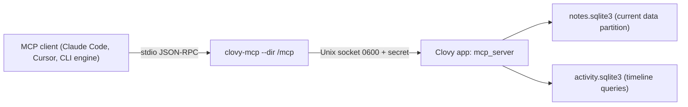

# Clovy MCP server

Local MCP clients (Claude Code, Cursor, and the CLI chat engines) read the
current data partition's notes, dictations, and memories, and the
installation's activity, through a stdio MCP server, `clovy-mcp`. It is on by
default (the switch in Settings, Agent turns it off, and the choice survives
restarts) and answers only while Clovy is open. A client outside a Clovy chat
turn (Cursor, `claude mcp add`) gets the read-only tools only. A CLI chat turn
(Claude Code, Codex, or Copilot started by Clovy) connects with a **turn
binding** and also gets the turn-bound tools: Clovy's write tools ask the
in-app **approval broker** before any effect.
Requirements: the `clovy-mcp-server` specs of the OpenSpec changes
`add-activity-intelligence` and `default-capture-and-session-mcp`, and the
`clovy-mcp-server` delta of `cli-substitui-agente-nativo` (which owns the
names of the turn-bound tools, [spec/mcp-tool-naming.md](../spec/mcp-tool-naming.md));
decision records: [ADR-0058](adr/0058-clovy-mcp-server-relays-to-the-running-app.md)
(the relay),
[ADR-0059](adr/0059-activity-is-per-installation-not-per-data-partition.md)
(activity has no partition), and
[ADR-0063](adr/0063-cli-turns-get-write-tools-through-an-approval-broker.md)
(turn binding and approval broker; `proposed` until the owner accepts the
parity proof). Terms are in
[CONTEXT.md](../CONTEXT.md#activity-capture). The flags each CLI turn gets are
in [llm-providers.md](llm-providers.md#cli-chat-engine).

## Where the code lives

| Path | What |
| --- | --- |
| `src-tauri/src/mcp_server/mod.rs` | Switch, listener lifecycle, Tauri commands, configuration snippets, per-message data access |
| `src-tauri/src/mcp_server/channel.rs` | Unix socket + installation secret, handshake, listener, client connect |
| `src-tauri/src/mcp_server/stdio.rs` | The `clovy-mcp` relay (and its answers while the app is unreachable) |
| `src-tauri/src/mcp_server/protocol.rs` | MCP JSON-RPC: lifecycle, `tools/*`, `resources/*`, `clovy://context`, `clovy://guide`, MCP content blocks |
| `src-tauri/src/mcp_server/turns.rs` | Turn registry: issue, bind, revoke turn tokens (`turn_required`, `turn_expired`) |
| `src-tauri/src/mcp_server/tools/mod.rs` | `ToolGroup`, `ToolCtx`, the group registry, `tools/list` and `tools/call` dispatch |
| `src-tauri/src/mcp_server/tools/read.rs` | The read tools every client gets, and their limits |
| `src-tauri/src/mcp_server/tools/` | One file per turn-bound group (`notes`, `memory`, `media`, `recorder`, `browser`, `computer_use`, `vault_skills`, `routines`, `connectors`, `gateway`, `interaction`), each with its `*_tests.rs` |
| `src-tauri/src/approval_broker/` | The approval broker: cards, wait with timeout, single decision, cancellation, startup cleanup |
| `src-tauri/src/chat_engine/policy.rs` | The flags each CLI turn gets (safety mode, attended, tool timeout) |
| `src-tauri/src/bin/clovy_mcp.rs` | Binary entry point |
| `src-tauri/bundle-clovy-mcp.sh` | macOS `beforeBundleCommand` step: copies and signs the binary into `.tauri-helper/` |
| `src/components/settings/McpServerSection.tsx`, `src/lib/mcp-server.ts` | Settings, Agent section and its bindings |

Tests: `cargo test mcp_server` (protocol against test databases, the relay
through a real socket, refusal without the secret, connection and request
limits, JSON-RPC validation, oversized lines, calendar context across
daylight-saving changes, serialized settings updates, coding-agent blocks, day
panels and schedule, turn binding and revocation (`turn_tests.rs`), and one
`tools/<group>_tests.rs` per turn-bound group with a test broker),
`cargo test approval_broker`, `src-tauri/tests/mcp_server_stdio.rs` (the built
`clovy-mcp` binary spawned over stdio against the app side served in the test
process, including the debug build's refusal of production data, a bound turn
until revocation, and image content blocks),
`src-tauri/tests/mcp_server_doc_catalog.rs` (the tool tables of this document
against `tools/list` for an unbound client and each kind of turn, and its
links and code paths), `src/test/mcp-server-section.test.tsx`,
`src/test/cli-approval-cards.test.tsx` (approval and clarification cards of
CLI turns), and `src/test/mcp-server-dev-runner.test.ts` (the development
runner builds the relay).

## Shape

The binary never opens a database: the activity key lives only in the
Keychain for the app, and the capture thread owns the activity store. It
relays each line to the app, which answers with the same queries, exclusions,
and retention as the agent tools and the "Today" view.

## Local channel

- Directory `<app data dir>/mcp/` (mode 0700): `clovy.sock` (Unix socket, mode
  0600) and `secret` (64 hex characters, mode 0600, created the first time the
  server starts and kept across restarts: the installation secret).
- The listener runs only while the switch is on; turning it off closes every
  connection and removes the socket. A socket left by a crash is replaced on the
  next start.
- Handshake: the client's first line is `{"clovyMcp": 1, "secret": "<hex>"}`,
  plus `"turn": "<token>"` when the relay was started with `--turn` (see
  [Turn binding](#turn-binding)). The app checks the peer's user id (same user
  only) and compares the secret in constant time, then the turn token if any,
  and answers `{"clovyMcp": 1, "ok": true}`, or
  `{"clovyMcp": 1, "ok": false, "error": "unauthorized"}` (or `"busy"`, see
  limits, or `"turn_expired"`) and closes.
- After `ok`: newline-delimited MCP JSON-RPC messages in both directions, at
  most 4 MiB per line; requests run concurrently and answers may arrive out of
  order (matched by `id`).
- Limits (any process of the same user can reach the socket; `channel.rs`):
  - at most 4 connections waiting for their handshake (5 s each); more are
    closed as soon as they are accepted, before any read;
  - at most 8 authenticated connections; the next gets `"busy"`;
  - at most 4 requests of one connection being answered at once; the app
    stops reading that connection until one finishes, so a fast client waits
    in its own socket buffer instead of growing the app's memory;
  - persistent `accept` errors (out of descriptors) back off 100 ms.
- Unix socket paths are limited to 104 bytes on macOS; a data dir deeper than
  that makes the server fail to start with the error shown in Settings.

## Turn binding

A CLI chat turn with Clovy's server (Claude Code, Codex, Copilot) issues a
**turn token** in the app's turn registry (`mcp_server::turns::TurnRegistry`,
one per app, kept across turning the server off and on) before the CLI starts.
The token (32 random bytes, 64 hex characters) is bound to the session, run,
CLI, safety mode, whether a person watches the turn (`attended`: chat `true`,
routines `false`), and the surface (`chat` or `routine`).

- The relay gets it as `--turn <token>` in the server arguments
  (`McpLaunch::for_turn`): Claude Code and Copilot in the temporary MCP
  configuration file, Codex in `-c mcp_servers.clovy.args`. It never goes into
  the prompt or the environment. It is visible to same-user processes in
  `ps`, which can already read the installation secret, and it opens nothing
  without that secret.
- The handshake carries it as the additive `turn` field; the protocol
  version stays `1`. `turn` absent or `null` is an unbound connection; an
  unknown or revoked token, or a value that is not a string, gets
  `"error": "turn_expired"`. The token is checked only after the secret and
  the user id. An older relay without `--turn`, or an older app that ignores
  `turn`, gives an unbound connection.
- A token serves every connection of the run (the relay reconnects) and is
  never reused by another run. It is revoked when the turn ends, fails, or is
  cancelled (`chat_engine::turn::TurnGrant`, and `cancel_cli_run` before the
  process is stopped), and on app shutdown (`revoke_all` in
  `shutdown::run_cleanup`). A revoked connection reads no new request,
  delivers the answers of the calls in flight for at most 2 s, then closes;
  a call still unanswered then, and every later call, gets
  `... (turn_expired)` from the relay.
- An unbound connection never sees a turn-bound tool in `tools/list`, and
  calling one returns an `isError` result ending in `(turn_required)` without
  running it.

## Approval broker

Every turn-bound tool that writes asks the approval broker
(`crate::approval_broker`) before any effect. The broker writes an
`interruption` item in the bound session (the same item the legacy Clovy
agent used, with `engine: "cli"` and `cli`; title and description come from
the tool's code, never from the model), moves the run to
`waiting_for_user`, emits `interruption.requested`, and waits for the
decision. The existing approval and clarification cards render it; the
answer goes through `resolve_agent_interruption`, which hands CLI items to
the broker. `once`, `session`, and `always` all approve this call only
(stored as `resolution: "once"`); `deny` denies. One decision is accepted;
a second or late answer gets `agent_interruption_expired`.

| Outcome | Tool error (`isError`, `message (code)`) | Item |
| --- | --- | --- |
| Approved | none: the tool runs and returns its result | `resolved`, `resolution: "once"` |
| Denied | `user_denied` | `resolved`, `resolution: "deny"` |
| No answer in 10 minutes (`APPROVAL_TIMEOUT`) | `approval_timed_out` | `expired`, `retiredReason: "timeout"` |
| Run cancelled, ended, or app closing | `run_cancelled` | `cancelled`, `retiredReason: "cancelled"` (`"restarted"` when found pending at startup) |
| Unattended turn (routine) | `unattended_requires_approval` | none: no card |
| Storage or broker unavailable | `approval_unavailable` | none: the tool does not run |

`APPROVAL_TIMEOUT` (10 minutes, fixed) is shorter than the tool timeout each
CLI turn gets (15 minutes, `chat_engine::policy::CLI_TOOL_TIMEOUT`, checked at
compile time). A clarification (`request_clarification`) is the same item
with `kind: "clarification"`, `question`, and `choices`; the answer is the
tool's result.
Browser use keeps its own approval tray instead (below), so one click never
shows two cards.

## The relay while Clovy is unreachable

`clovy-mcp` answers by itself so the client sees why: `initialize` and `ping`
succeed (the instructions carry the reason), `tools/call` returns an
`isError` result with the reason, other requests fail with JSON-RPC error
`-32000`. Reasons: never turned on (no secret yet), off or Clovy not open (no
socket or nobody listening), secret refused, every connection slot busy, or
Clovy closed the connection mid-request (pending requests get that error).
Each message retries the connection, so turning the server on (or opening
Clovy) needs no client restart.

The relay also validates its input before anything reaches the app: a stdin
line longer than 4 MiB is skipped to its newline without being kept and
answered with `-32600` (id `null`); a line that is not JSON gets `-32700`; an
object that is not a valid JSON-RPC 2.0 request or notification (no or
non-string `method`, `jsonrpc` other than `"2.0"`, an id that is not a string
or number, a batch array) gets `-32600` with its id when usable. The app
applies the same validation to messages it receives. Notifications and
responses sent by the client get no answer.

**Debug builds and production data.** A debug `clovy-mcp` refuses a `--dir`
under the installed app's data directory
(`~/Library/Application Support/co.opensoftware.june`), answering every
message with that reason, unless `OS_CLOVY_USE_PROD_DATA_DIR` is set (the same
opt-in the debug app honors). Development snippets point at the `-dev` data
directory.

## Tools and resources

Names are fixed in the `clovy-mcp-server` specs (the read tools) and in the
`clovy-mcp-server` delta of `cli-substitui-agente-nativo` (the turn-bound
tools). `src-tauri/tests/mcp_server_doc_catalog.rs` compares the tables below
with `tools/list`. Notes, dictations, and memories are limited to the current
data partition; activity tools read the installation's activity, whichever
partition is open ([ADR-0059](adr/0059-activity-is-per-installation-not-per-data-partition.md)).
Activity tools are listed only while activity capture is on and refuse with
`activity_capture_off` otherwise; they apply the current app and domain
exclusions and the retention period like the agent tools
([activity-timeline.md](activity-timeline.md)). Tool failures come back as
`isError` results with `message (code)`.

### Tools for every client

Every connection, bound or not, gets these read-only tools (`readOnlyHint`).

| Tool | Arguments | Result and limits |
| --- | --- | --- |
| `search_notes` | `query`, `limit` (1-20, default 10) | Notes whose title, text, or a transcript contains `query`: id, title, snippet (about 160 characters around the match), `matchedIn`, dates |
| `get_note` | `id`, `contentOffset`, `transcriptOffset` | Title, text in pages of 20,000 characters (`contentTruncated`, `contentTotalChars`, `nextContentOffset`), latest transcript in pages of 40,000 characters (`nextTranscriptOffset`); offsets count characters |
| `list_dictations` | `query`, `limit` (1-50, default 20), `offset` | Dictations of the last 7 days, newest first, text up to 4,000 characters each, `hasMore`/`nextOffset` |
| `list_memories` | `projectId`, `includeGlobal`, `limit` (1-20, default 8), `offset` | Same as the agent tool; refuses while memory is off (globally or for the project) |
| `get_activity_timeline` | `from`, `to` | The agent tool: sessions, gaps, stats (300 sessions/gaps at most, `truncated`) |
| `search_activity` | `query`, `from`, `to`, `limit` (1-50) | The agent tool: moments, app, window, URL, snippet |
| `get_activity_stats` | `from`, `to` | Focused, idle, away minutes, top 5 apps, minutes per category |
| `get_active_session` | none | The session in progress and the ongoing gap (looking back 12 hours); `lastSession` when nothing is active |
| `list_app_usage` | `from`, `to`, `limit` (1-100, default 20) | Minutes and session count per app, most used first, `totalApps`, `truncated` |
| `get_session_detail` | `id` | Session, its windows and URLs (windows on excluded domains dropped, and the text excerpt with them), text excerpt; sessions excluded or past retention are "not found" |
| `list_coding_agent_sessions` | `from`, `to`, `limit` (1-50, default 20) | Coding-agent blocks overlapping the period ([coding-agent-sessions.md](coding-agent-sessions.md)), newest first: id, agent, source, session id, project, title, start and end, `activeMinutes`, prompts, replies, state, summary (else `firstPrompt`); only sources turned on in Settings, Activity and blocks within the retention period; never the transcript or the working directory; `totalBlocks`, `truncated` |
| `get_day_summary` | `date` (optional local `YYYY-MM-DD`, default today) | Day summary (headline, narrative, insights, standup: done, inProgress, blockers, hoursCovered, locale, provider, trigger, generatedAt), workstreams (each hour with `periods` `[{startedAt, endedAt}]`, the bounds of the measured sessions its work was located in, not its duration, or null when only the hour is known, and `locatedMinutes`, the minutes those periods cover), and hour reports (each activity with its `periods`, same shape, or null); `summary: null` with `state: "not_generated"` when none exists yet; respects retention |
| `get_day_panels` | `date` (optional local `YYYY-MM-DD`, default today) | The summary's panels as the "Today" view draws them (`pipeline::day_view`, [day-intelligence.md](day-intelligence.md)), recomputed at each call: `focusedMinutes`, `idleMinutes`, `awayMinutes`, `topApps`, `categories`, `hours` (`[{hour: "YYYY-MM-DDTHH", focusedMinutes}]`, every local hour of the day), `workstreams` (`[{id, title, minutes}]`, 20 at most, `totalWorkstreams`, `truncated`), `meetings` (`count`, `minutes` of the recorded notes of the open data partition), `codingAgents` (`blocks`, `activeMinutes` of the sources turned on, prorated to the day); activity and blocks before the retention floor are left out, and a date before it answers `state: "past_retention"` with `panels: null` |
| `get_day_schedule` | none | `summaryTime` (local `HH:MM` the day summary is written), `notifications` (`enabled`, `quietHours`: `enabled`, `start`, `end`) from Settings, Activity |

### Tools for turn-bound connections

Listed and callable only on a connection bound to a turn. "Listed to" says
which turns see the tool: `every turn`, `attended turns` (chat; never
routines), or `Claude turns`. A `Claude turns` tool is listed for Claude Code
itself, not for the model: every Claude turn with Clovy's server, attended or
not, gets `--disallowedTools mcp__clovy__<tool>` (`chat_engine::policy`). "Broker" says what the call asks first: `yes`
(an approval card for every call), `clarification` (a question card), `tray`
(Browser use's own approval tray for consequential actions), or `no`. In an
unattended turn every `yes` and `clarification` answers
`unattended_requires_approval` without a card.

| Tool | Group | Listed to | Broker | Arguments and result |
| --- | --- | --- | --- | --- |
| `get_dictation` | notes | every turn | no | `id`, `textOffset`: one retained dictation (same 7-day floor as `list_dictations`) in pages of 40,000 characters (`textTotalChars`, `nextTextOffset`) |
| `save_memory` | memory | every turn | yes | `content` (up to 4,000 characters), `projectId`: saves one memory (`source: "agent"`); refuses while memory is off globally or for the project, checked again after approval |
| `forget_memory` | memory | every turn | yes | `id`: forgets one memory (with its tombstone); same gates |
| `list_routines` | routines | every turn | no | none: routines and their schedules |
| `create_routine` | routines | every turn | yes | `name`, `prompt`, `schedule` (RFC 3339, `every <n>m/h/d`, or five-field cron), `safetyMode` (`sandboxed`, `unrestricted`); `prompt`, `schedule`, `safetyMode` required |
| `update_routine` | routines | every turn | yes | `routineId` and any of `name`, `prompt`, `schedule`, `safetyMode` |
| `pause_routine` | routines | every turn | yes | `routineId` |
| `resume_routine` | routines | every turn | yes | `routineId` |
| `delete_routine` | routines | every turn | yes | `routineId`: deletes it permanently |
| `get_obsidian_vault` | vault and skills | every turn | no | none: the selected Obsidian vault; discovery never authorizes writes (the CLI reads the files itself) |
| `list_skills` | vault and skills | every turn | no | none: the globally enabled Clovy skills (`agent_skill_settings`) |
| `load_skill` | vault and skills | every turn | no | `name`: instructions of one globally enabled skill; a disabled one is refused |
| `start_session` | browser | attended turns | tray | none: starts an attended Browser use session |
| `close_session` | browser | attended turns | tray | `session_id` |
| `navigate` | browser | attended turns | tray | `session_id`, `url` |
| `snapshot` | browser | attended turns | tray | `session_id`: the page as element refs |
| `screenshot` | browser | attended turns | tray | `session_id`: the PNG as an `image` block plus the broker's result as text |
| `click` | browser | attended turns | tray | `session_id`, `ref` |
| `fill` | browser | attended turns | tray | `session_id`, `ref`, `value` |
| `press` | browser | attended turns | tray | `session_id`, `key` |
| `back` | browser | attended turns | tray | `session_id` |
| `list_tabs` | browser | attended turns | tray | `session_id` |
| `open_tab` | browser | attended turns | tray | `session_id`, `url` (optional) |
| `switch_tab` | browser | attended turns | tray | `session_id`, `tab_id` |
| `close_tab` | browser | attended turns | tray | `session_id`, `tab_id` |
| `accept_shared_tab` | browser | attended turns | tray | `session_id`, `share_code` |
| `computer_use` | computer use | attended turns | yes | `action` (`capture`, `list_apps`, `wait`, `open_app`, `focus_app`, `click`, `double_click`, `right_click`, `drag`, `scroll`, `type`, `key`, `set_value`) and its arguments: every call asks first (also on a linked phone, once); the turn binding opens the run's lease; the capture comes back as an `image` block |
| `generate_image` | media | every turn | no | `prompt`: bills Clovy API (or the user's fal key); the file goes to `artifacts/` of the bound session's workspace and `agent_artifacts`, and comes back as an `image` block while under 3 MiB |
| `edit_image` | media | every turn | no | `sourcePath` (relative to the session workspace or absolute), `instruction`: same storage |
| `generate_video` | media | every turn | no | `prompt`, `duration`, `aspectRatio`, `audio`, `jobId` (resumes a job): polls within the CLI's tool timeout; same storage |
| `start_recording` | recorder | every turn | yes | `sourceMode` (`microphoneOnly`, `microphonePlusSystem`): the frontend starts the visible recording (ADR-0013) after approval |
| `stop_recording` | recorder | every turn | yes | none: stops the visible recording |
| `recording_status` | recorder | every turn | no | none: whether Clovy is recording, with its metadata |
| `request_clarification` | interaction | every turn | clarification | `question`, `choices`: the user's answer is the result |
| `approve_action` | interaction | Claude turns | yes | `tool_name`, `input`, `tool_use_id`: Claude Code's `--permission-prompt-tool`; answers `{"behavior":"allow","updatedInput":...}` or `{"behavior":"deny","message":...}`; kept from the model by `--disallowedTools` in every Claude turn |

Browser use and `computer_use` are not listed to unattended turns and refuse
them with `unattended_requires_approval`. Browser use runs over the same
`BrowserBroker` as the legacy agent: a consequential action on an origin not
yet allowed parks in the browser approval tray
(`browser_approvals_pending` / `browser_approval_respond`) and answers
`{parked: true, actionId}`; the approval broker is not asked again.

### Connector tools

Listed to a bound turn per connected account with the scope each tool needs
(Gmail and Calendar share the Google account), and Notion's per its hosted
server's inventory, filtered by the allowlist. The catalog is cached per turn
for 15 s and is never an authorization: the account's scopes are checked
again at each call, after the approval for mutations. Tokens stay in the
app. A mutation denied by the user makes no request to the provider. A
connector that cannot be discovered drops its tools from the list without
failing `tools/list`.

| Tool | Connector | Broker |
| --- | --- | --- |
| `search_threads` | Gmail | no |
| `read_thread` | Gmail | no |
| `list_unread` | Gmail | no |
| `create_draft` | Gmail | yes |
| `send_email` | Gmail | yes |
| `modify_labels` | Gmail | yes |
| `archive` | Gmail | yes |
| `list_events` | Calendar | no |
| `get_event` | Calendar | no |
| `find_free_slots` | Calendar | no |
| `create_event` | Calendar | yes |
| `respond_to_invite` | Calendar | yes |
| `list_repositories` | GitHub | no |
| `get_pull_request` | GitHub | no |
| `search_issues` | GitHub | no |
| `get_issue` | GitHub | no |
| `list_issue_comments` | GitHub | no |
| `create_issue` | GitHub | yes |
| `update_issue` | GitHub | yes |
| `add_comment` | GitHub | yes |
| `notion-search` | Notion | no |
| `notion-fetch` | Notion | no |
| `notion-query-data-sources` | Notion | no |
| `notion-query-database-view` | Notion | no |
| `notion-get-comments` | Notion | no |
| `notion-get-enhanced-markdown-specification` | Notion | no |
| `notion-get-view-configuration-dsl` | Notion | no |
| `notion-create-pages` | Notion | yes |
| `notion-update-page` | Notion | yes |

Notion actions are bound to the broker's approval id (in place of the legacy
digest by run and call id). Notion names are the hosted server's, not ours
([spec/mcp-tool-naming.md](../spec/mcp-tool-naming.md), exceptions).

### MCP gateway (user servers and Linear)

A bound turn also lists the enabled tools of the user's MCP servers
(`mcp_<server>_<tool>`) and of the managed Linear server (`mcp_linear_*`),
discovered per turn through `agent_mcp` with its visibility rules, timeouts,
output limit, and Seatbelt for stdio servers in a `sandboxed` session. A tool
the server's policy marks as needing approval (the default for user servers;
Linear by its annotations) asks the broker first. An elicitation from the
server becomes a clarification card. Headers, environment, and OAuth tokens
stay in the Keychain and the app's memory, never in the CLI's argv,
environment, or files. A server that cannot be discovered drops its tools
from the list without failing `tools/list`.

### Content blocks

A tool result is one `text` block with the result as JSON, except
`computer_use`, `screenshot`, and the image tools, which return MCP content
blocks (`protocol::content_value`): images as `image` blocks (up to 3 MiB in
base64; a larger one stays in Clovy) and the rest as `text`.

### Times and resources

Activity times are RFC 3339 with offset; omitted bounds mean today so far. `get_day_summary` and `get_day_panels` take a local date `YYYY-MM-DD` (default today).

`get_day_summary` preserva os `minutes` existentes e expõe `seconds` nas
atividades, frentes e horas de cada frente, além de `locatedSeconds` nas horas.
`get_day_panels` também inclui `seconds` nas frentes. Esses campos mantêm o
tempo exato: três atividades de 40 s somam 120 s, mesmo que cada `minutes`
arredondado seja 1. Dados antigos sem segundos usam `minutes * 60` (ou
`locatedMinutes * 60` para o tempo localizado); zero explícito não usa fallback.

Sessions and gaps leave out the app's `bundleId` and the gap's `id`: the
"Today" view uses them only for app icons and list keys, and no tool takes a
gap id.

Resources: `clovy://context` (JSON: `now`, `date`, `time`, `weekday`,
`timeZone` (IANA name from `TZ` or `/etc/localtime`), `utcOffset`,
`yesterday`, `startOfToday`) and `clovy://guide` (Markdown: which tool answers
which question, dates, limits, privacy). `yesterday` is the previous local
date and `startOfToday` the first local moment of today with the offset in
force then (midnight, or the first minute after a daylight-saving jump that
skips it), not "now minus 24 hours" or now's offset.

## Configuration for clients

`mcp_server_status` returns the snippets the Settings section copies; they all
run the bundled binary with the channel directory:

- Command: `<Clovy.app>/Contents/Resources/native/bin/clovy-mcp` (development
  builds: next to the app executable in `src-tauri/target/<profile>/`;
  `scripts/cargo-clovy-runner.sh` builds it with the app on every
  `pnpm tauri:dev`).
- Args: `["--dir", "<app data dir>/mcp"]`. No environment variables.
- Claude Code: `claude mcp add --scope user clovy -- <command> --dir '<dir>'`,
  or `{"mcpServers": {"clovy": {"type": "stdio", "command": ..., "args": [...]}}}`
  in `.mcp.json` / `--mcp-config`.
- Cursor: the same object without `type` in `~/.cursor/mcp.json`.

Moving Clovy.app changes the command path; copy the configuration again.

### For child processes (CLI chat engines)

`crate::mcp_server::child_process_launch(&app)` returns the `McpLaunch`
(`command`, `args`; no env) or `mcp_server_binary_missing`;
`crate::mcp_server::claude_code_config(&launch)` builds the `mcpServers` object
to write to a temporary file for `claude --mcp-config <file>` or translate
for another CLI. `McpLaunch::for_turn(token)` adds `["--turn", token]` for a
turn-bound connection ([Turn binding](#turn-binding)). The server must be on
for its tools to answer; otherwise the child gets the relay's "off" errors.

## Storage of the switch

`mcpServer` in `activity-settings.json` (default `true`; profiles saved before
it became default-on are turned on once, see the defaults upgrade in
[activity-capture.md](activity-capture.md#settings-activity-settingsjson-app-config-dir)).
Only `mcp_server_set_enabled` changes it; `activity_save_settings` keeps the
stored value so a stale Activity tab cannot flip it. Both go through
`ActivityShared::update_settings`, which holds one lock across reading the
latest settings, writing the file, and publishing them, so an Activity save
and an MCP toggle at the same moment never undo each other. A save whose
write fails returns `activity_settings_save_failed` and changes nothing. App
setup schedules the listener start when the switch is on
(`McpServerState::apply_switch`), whether or not capture is on or has its
permissions; activity tools are offered only while capture is on. Nothing
waits for the listener: CLI chat engines get the launch whenever the switch is
on, and tools and resources answer once the listener is ready. A request that
arrives earlier gets the relay's own answer: `initialize` and `ping` succeed
locally, `tools/call` returns an error result, and other requests (such as
`tools/list` and `resources/*`) fail, both with the unreachable reason. The
relay opens a new connection for a later request when it has none, so
requests after the listener is ready reach the app. macOS only
(`supported: false` elsewhere hides the section).
